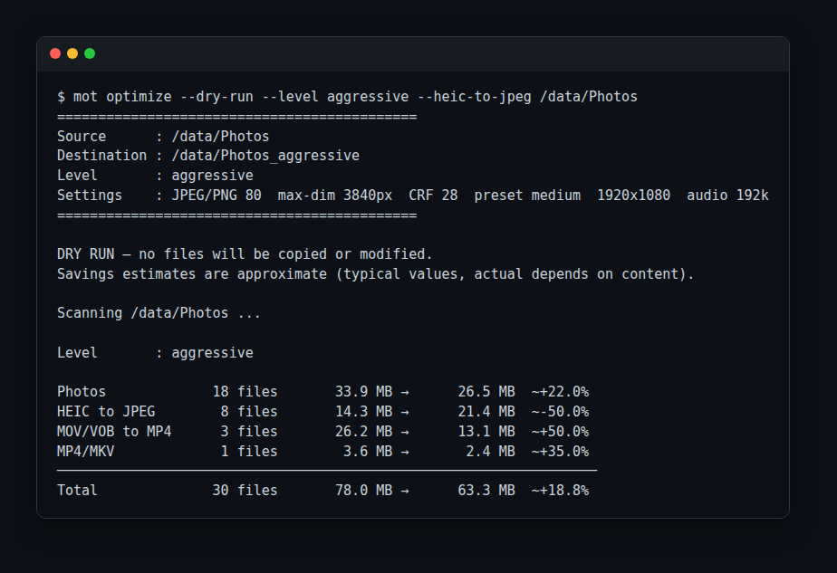
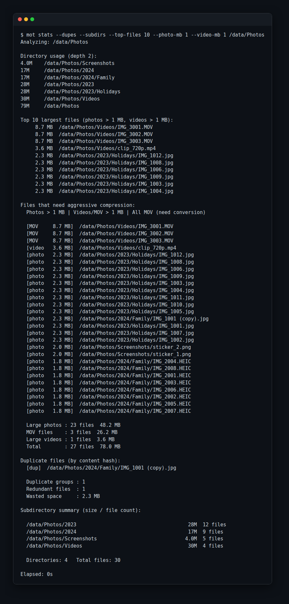

# media-optimize-tools

[](https://github.com/okarabudka/media_optimize_tools/actions/workflows/ci.yml)

`mot` is a small Bash CLI that shrinks photo and video archives without risking the originals: it copies the archive
with rsync and recompresses only the copy. It also reports where the space goes and finds duplicate files. Runs from a
Docker image or directly on Linux with rsync, ImageMagick and ffmpeg.

## Why it exists

It started between December 2025 and April 2026 as a set of personal scripts to fit family photo and video backups
(phone dumps on a USB drive) into less space. An audit of those scripts found ways they could lose data: a PNG
converted to JPEG overwrote an existing `name.jpg`, transparency was flattened, videos were replaced by larger
re-encodes, and every result lost its file date. This version fixes those, has a single entry point, tests for each of
the failure cases, and a Docker image with all dependencies, so it can be trusted with an archive that has no second
copy yet.

## What you get

**Non-destructive by design.** `mot optimize SOURCE [DEST]` copies `SOURCE` with `rsync -a` and only changes the copy.
A file in the copy is replaced only when the result is smaller, or when a format conversion was asked for.

**Formats.**

| Input                         | What happens                                                      |
|-------------------------------|-------------------------------------------------------------------|
| JPEG, WEBP                    | recompressed and resized to the preset's limit, EXIF/ICC/XMP kept |
| PNG without transparency      | converted to JPEG (`--keep-png` keeps it as PNG)                  |
| PNG with transparency         | stays PNG; `--optimize-png` recompresses losslessly               |
| HEIC, HEIF                    | untouched; `--heic-to-jpeg` converts to JPEG for compatibility    |
| MOV, VOB                      | H.264/AAC MP4, metadata and creation time kept, `+faststart`      |
| MP4, MKV, AVI, M4V, WEBM, MPG | re-encoded at `moderate` and above                                |

**Presets.** `--level` picks one; every value can be overridden (`--jpeg-quality`, `--max-image-dim`, `--crf`,
`--preset`, `--max-width`, `--max-height`, `--audio-bitrate`).

|                    | `archive`       | `moderate` (default) | `aggressive`   | `maximum`     |
|--------------------|-----------------|----------------------|----------------|---------------|
| JPEG quality       | 95              | 88                   | 80             | 70            |
| Longest photo side | no limit        | 8000 px              | 3840 px        | 2560 px       |
| Video CRF, preset  | 20, slow        | 25, medium           | 28, medium     | 32, medium    |
| Max video size     | 3840x2160       | 3840x2160            | 1920x1080      | 1280x720      |
| AAC bitrate        | 256k            | 192k                 | 192k           | 128k          |
| MP4/MKV/AVI        | left as is      | re-encoded           | re-encoded     | re-encoded    |

**Workflow helpers.** `--dry-run` estimates savings per type without touching anything. `--resume` continues an
interrupted run (progress is kept in `.optimize_progress` in the copy). `--jobs N` runs workers in parallel,
`--only-exts`/`--skip-exts` and `--min-photo-mb`/`--min-video-mb` limit what is processed, `--skip-copy` optimizes an
existing copy in place, `--log FILE` keeps a log. A summary with the top savings and `mot stats` of the original and the
copy are printed at the end.

**Statistics and duplicates.** `mot stats` shows folder sizes, the largest files and the files that would profit most
from compression (`--subdirs` for a per-folder summary). Duplicates are found by content (size first, then MD5):
`stats --dupes` reports them, `optimize --copy-dupes DIR` copies the redundant files for review, `optimize
--delete-dupes` deletes them after a confirmation. The alphabetically first file of each group is always kept.

## Safety guarantees

What `mot` never does, each backed by a test in `tests/`:

- **The source folder is never changed by `optimize`.** All work happens on the rsync copy; the run refuses a
  destination that exists, equals the source, or is nested in it. The only command that deletes from the folder you
  pass is `optimize --delete-dupes`, and only after you answer `y` (or pass `--yes`); without a terminal it aborts.
- **No existing file is overwritten.** When a conversion changes the extension (PNG/HEIC to JPEG, MOV/VOB to MP4) and
  `name.jpg` or `name.mp4` already exists, the result is written as `name-1.jpg`, `name-2.jpg`, and so on. The name is
  reserved atomically, so parallel workers cannot collide either.
- **No file gets bigger.** Photos and videos are replaced only by a smaller result; a larger re-encode is discarded and
  the original kept (also as MOV). The one exception is `--heic-to-jpeg`, which you request for compatibility.
- **Transparency is not lost.** A PNG with transparent pixels is never converted to JPEG.
- **Dates and metadata stay.** Every result gets the source file's modification time and permissions. Photos keep EXIF
  (capture date, GPS, camera), ICC and XMP; videos keep container metadata such as `creation_time` and QuickTime tags
  like the location.
- **Failures leave the file alone.** A file that ImageMagick or ffmpeg cannot process stays as it was, is counted as
  failed in the summary and is retried by `--resume`. Temp files are hidden (`.mot-tmp.*`) and removed.

Still, keep the original until you have checked the copy: compare file counts, open some photos and videos, and look
at the dates.

## How to use it

Requirements: Docker. Without Docker: Bash 4.4+, GNU coreutils/findutils, rsync, ImageMagick (7 or 6), ffmpeg with
libx264, python3 (only for duplicates) and libheif for HEIC (Debian/Ubuntu: `sudo apt install rsync imagemagick
ffmpeg python3 libheif-plugin-libde265`).

### With Docker

```bash
make image   # builds ghcr.io/okarabudka/media-optimize-tools

docker run --rm --user "$(id -u):$(id -g)" -v /media/usb:/data \
    ghcr.io/okarabudka/media-optimize-tools optimize --dry-run --level aggressive /data/Photos

docker run --rm --user "$(id -u):$(id -g)" -v /media/usb:/data \
    ghcr.io/okarabudka/media-optimize-tools optimize --level aggressive /data/Photos /data/Photos_aggressive
```

Mount the folder that contains the archive and keep the destination inside the mount, otherwise the copy disappears
with the container. `--user` makes the copy belong to you instead of root. Add `-it` to answer confirmations.

### Without Docker

```bash
bin/mot --help                  # or ./run.sh, kept for existing scripts
ln -s "$PWD/bin/mot" ~/.local/bin/mot
```

### Typical workflow

```bash
# 1. See what takes space, what needs compression and what is duplicated
mot stats --dupes /media/usb/Photos

# 2. Estimate the savings
mot optimize --dry-run --level aggressive --heic-to-jpeg /media/usb/Photos

# 3. Create the optimized copy /media/usb/Photos_aggressive (4 workers)
mot optimize --level aggressive --heic-to-jpeg --jobs 4 /media/usb/Photos

# 4. If it was interrupted, continue with the same level
mot optimize --resume --level aggressive /media/usb/Photos_aggressive
```

More examples:

```bash
# Only convert MOV, keep everything else as is
mot optimize --only-exts mov --level aggressive /media/usb/Photos

# DVD backups at near-lossless quality
mot optimize --level archive --only-exts vob /media/usb/DVD_backup

# Screenshots: keep PNG, recompress losslessly
mot optimize --keep-png --optimize-png --only-exts png /media/usb/Screenshots

# Re-compress only what is still large in an existing copy
mot optimize --skip-copy --level aggressive --min-photo-mb 4 --min-video-mb 80 /media/usb/Photos_aggressive

# Duplicates: report, copy for review, delete
mot stats --dupes /media/usb/Photos
mot optimize --copy-dupes /tmp/dupes_review /media/usb/Photos
mot optimize --delete-dupes /media/usb/Photos
```

### Before and after

Measured on a generated sample folder (`/data/Photos`, created by ImageMagick and ffmpeg, no real media) with the
Docker image on a 16-thread desktop, `mot optimize --level <level> --heic-to-jpeg --jobs 4`. Sizes are the sum of file
sizes; the wall time includes the rsync copy and the closing statistics.

Input: 30 files, 78.0 MB (12 JPEG, 1 duplicate JPEG, 8 HEIC, 3 opaque PNG screenshots, 2 PNG with transparency,
3 MOV at 1080p, 1 MP4 at 720p).

| Level        | Files after | Size after | Saved  | Wall time |
|--------------|-------------|------------|--------|-----------|
| `archive`    | 30          | 72.4 MB    | 7.2 %  | 14.3 s    |
| `moderate`   | 30          | 40.9 MB    | 47.6 % | 13.0 s    |
| `aggressive` | 30          | 26.6 MB    | 65.9 % | 12.9 s    |
| `maximum`    | 30          | 12.0 MB    | 84.6 % | 9.9 s     |

At every level the file count stays the same (each conversion replaces its source), the PNGs with transparency stay
PNG, the screenshots stay PNG because the JPEG would have been larger, and all files keep their June 2024 dates.

The photos are synthetic fractal noise and the videos are test patterns, so the ratios show the mechanics, not what a
real camera roll will save. On real phone archives most of the gain comes from MOV to MP4 and from large JPEGs; HEIC
to JPEG makes files larger.

### Screenshots





The plain-text output behind them is in [docs/dry-run.txt](docs/dry-run.txt) and [docs/stats.txt](docs/stats.txt).

### Testing

```bash
make test    # builds the test image and runs the bats suite in it
make lint    # shellcheck and shfmt -d
```

The tests use bats-core in an image built from the runtime image, so they run against the same ImageMagick, ffmpeg and
libheif that ship. Fixtures are generated per test (64 to 160 px images, a PNG with transparency, one-second `testsrc`
clips, HEIC when the encoder is available) and cover the dry run, resume, parallel jobs, duplicates, the name
collision cases, transparency, the "video not replaced when larger" rule, mtime, EXIF and video metadata. GitHub
Actions runs lint, tests, an image build and a gitleaks secret scan.

## Repository layout

```
bin/mot              entry point: subcommands, --help, --version
lib/common.sh        shared helpers: errors, formatting, confirmations
lib/optimize.sh      mot optimize: presets, copy, per-file processing, resume, duplicates
lib/stats.sh         mot stats: disk usage, largest files, duplicates report
lib/find_dupes.py    duplicate finder (size, then MD5)
tests/               bats tests and fixture helpers
run.sh               thin wrapper around bin/mot
Dockerfile           runtime image and test image
```

## Status

Maintained.

## License

MIT, see [LICENSE](LICENSE).
